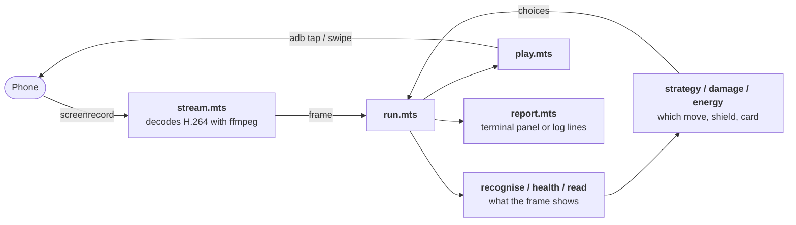

# Trainer battles

`pnpm battle` plays Pokémon GO's trainer battles on an Android phone over `adb`: Team Leader training, or GO Battle
League against other trainers. How to run it is in the [root README](../../../README.md#trainer-battles) and in the
usage at the top of [`scripts/battle.mts`](../../../scripts/battle.mts). This page is for working on it: how it is put
together, and the strategy it plays by.

## How it works

A battle turns every half second, and a screenshot over `adb` takes 0.8–1.9s, so the bot cannot look at the game the way
`pnpm inventory` does. It watches the screen as video instead, decides something about every frame, and acts with taps
and swipes. The menus between battles are slower and change rarely, so those are read off full screenshots.

### Watching the screen

- **[`stream.mts`](stream.mts)** runs `screenrecord` on the phone, which sends H.264 at about 30 frames a second, and
  decodes it with `ffmpeg` into the same `Image` the inventory readers take. `Screen` keeps one recording going after
  another, since `screenrecord` stops after 180s, and always answers the latest frame.
- **[`layout.mts`](layout.mts)** places a position on a phone of any shape. The game sizes things by the screen's width
  and pins each piece at a fraction of the height, its _anchor_: 0 for the top, 1 for the foot, something in between for
  a piece inside a panel. So a position down the screen is written as its anchor and a number of the screen's widths
  from it, which is the same on every phone, and no phone's shape is the reference. Anchors are measured on both a Pixel
  8 Pro and a Pixel 4 XL.

### Reading a frame

Everything read per frame is done by colour samples, which are cheap. OCR is slower, about 220ms a read, so it is kept
for text and done every few seconds.

- **[`recognise.mts`](recognise.mts)** says which part of a battle a frame shows: `battle`, `charged` (a charged-move
  button is lit), `shield` (the Protect Shield prompt), `switch` (the prompt after a faint) or `other` (a charged move
  playing, a banner, the result, a menu). It also reads which charged-move buttons are lit, each side's shields from the
  hexagons in the HUD, and each side's Pokémon left from the three Poké Balls beside them.
- **[`health.mts`](health.mts)** finds each side's HP bar. The camera moves both bars around the screen, so they are
  searched for: a strip of the fill's green, yellow or red with the bar's outline around it. Where a strip starts across
  the screen says whose it is.
- **[`read.mts`](read.mts)** reads text with Tesseract:
  - **The HUD:** both names along the top and the CP beside each. Our name is the species unless the Pokémon has a
    nickname.
  - **The buttons:** the charged move printed under each one, matched to the moves our species can hold.
  - **The banner:** the line a charged move puts up as it lands, `Tyranitar used Crunch!`. This is the only direct view
    of the opponent's moves.

### Acting on a frame

- **[`play.mts`](play.mts)**' `Player` turns a frame's state into an action: a swipe, a tap or a wait. A swipe across
  the field fires a fast move, about six a second. A charged move is tapped the moment the chosen button lights; with
  none chosen, whichever lit first. A state must hold for a few frames before it is answered, because a prompt sliding
  in matches for a frame or two on its own. A tap isn't repeated within a second, and nothing is swiped for 0.7s after a
  charged-move tap, since a swipe straight after one could cost the throw.
- **[`minigame.mts`](minigame.mts)** finds the charged-move minigame's bubbles. They are discs of the thrown move's type
  colour, read off the game's own icon for the type and washed towards white. Each chain of them is swiped along its
  length. Where none are found, rows are swept instead.

### Between battles

- **[`menus.mts`](menus.mts)** reads the screens between battles off full screenshots and says where to tap.
  - **Training:** there is no rematch, so it goes round every time: the result's ✓, the leader on the Battle tab,
    BATTLE, the league, USE THIS PARTY.
  - **GO Battle League:** BATTLE on its card, the welcome before a set, the league chooser, the party (optionally a
    saved party named by `--party`, searched for along the carousel), matchmaking, and NEXT BATTLE. A set's reward is
    left to be collected by hand.
  - **From the map:** the Poké Ball, then BATTLE on the main menu.
  - **How it reads:** colour where that settles it, as for the leaders' portraits and the green buttons, and OCR for
    screens told apart by their words. GO Battle League's party screen also states the league's CP cap.
- **[`party.mts`](party.mts)** says which species each party card holds by silhouette, by laying each form icon's
  outline over the card. The card's own name is no help, since it may be a nickname. Silhouettes rather than colours,
  because a shiny is drawn in colours its icon doesn't have.

### The run loop

**[`run.mts`](run.mts)** ties it together, one frame at a time:

1. **Recognise the frame.** On the first non-`other` frame of a battle, everything about the last battle is reset.
2. **Read cheap things every frame:** shields, Pokémon left and HP bars. A bar of the opponent's reading fuller than
   before means a new Pokémon, HP never coming back, so its name and CP are dropped and read again at once.
3. **Read text every 3s,** or at once after a switch: names, CPs and our move labels. After a shield prompt, the banner
   is looked for for 8s, beside the battle rather than holding it up.
4. **Update the opponent's energy count** from our bar ([below](#the-opponents-energy)).
5. **Decide:** whether a shield would be taken, which button to throw, which card to send in after a faint, and whether
   to switch when the opponent does. That is `strategy.mts`, `damage.mts` and `energy.mts`.
6. **Act:** hand the state and the decisions to `Player`, then perform its swipe, tap or wait.
7. **Off the battle:** once a screen has read `other` for 1.5s, take a screenshot and read it as a menu, again beside
   the battle. If nothing at all has been recognised for 20s, stop with `Lost`, keeping the last frames for
   `--keep-frames`.

`run` is driven through a `Phone` (latest frame, screenshot, tap, swipe) and a `Clock`, never `adb` directly, so tests
stand in a scripted phone that plays committed frames as scenes.

**[`report.mts`](report.mts)** is how a run tells of itself: events (a tap, a throw, a shield taken and why, a faint)
and a status sent every frame. On a terminal, `live` draws a fixed full-screen panel with our side on the left and the
opponent's on the right. Where the terminal speaks the Kitty graphics protocol, as Kitty, Ghostty and WezTerm do, the
phone's latest frame is drawn down the panel's left edge at full height, so long as the table beside it still has 80
columns. [`kitty.mts`](kitty.mts) draws it, passing each frame as a temporary file the terminal reads, and asks the
terminal first, so one that can't read the file, such as a remote one, draws no picture rather than a broken one. Where
stderr isn't a terminal, `plain` writes lines instead, which is what `--verbose` gives there.

### Game data

- **The game master,** from [`../inventory/download.mts`](../inventory/download.mts): every form's types, stats and move
  pool, and every move's trainer-battle power, energy, duration in turns, and stat changes. It is downloaded and cached
  for a week; tests read the vended [`../inventory/fixtures/game-master.json`](../inventory/fixtures/game-master.json).
- **[`meta.mts`](meta.mts)** reads [PvPoke](https://pvpoke.com)'s rankings for the league being played in GO Battle
  League. It matches `--league` to PvPoke's cup by title; a cup PvPoke doesn't list falls back to its league's open
  rankings. For each species it gives the moves its players run and the recommended fast move. A species' forms and
  shadow are merged, since the HUD names only the species. If nothing matches, or PvPoke can't be reached, every move
  stays allowed for. Training never uses it.

### Testing

Each reader is tested against committed frames in [`fixtures/`](fixtures/), PNGs and H.264 clips stored with Git LFS,
from both a Pixel 4 XL and a Pixel 8 Pro. Each threshold in the code is quoted beside the frames it was measured on.
`run.test.mts` plays whole battles through a scripted phone. New fixtures come from `pnpm battle record`. Before a
capture is committed, the account's trainer names and the Nearby Battle QR code must be filled in solid (see
[`CLAUDE.md`](../../../CLAUDE.md)).

## Gameplay strategy

The bot plays with far less information than a person watching the screen. Most of the strategy is about filling the
gaps safely.

**What it can see:**

- **The HUD:** each side's species and CP, HP bar, shields and Pokémon left.
- **Our side:** which of our charged-move buttons are lit, and the moves under them.
- **Banners:** the opponent's charged moves as they land.

**What it can't see:**

- either side's IVs or level, or our own energy
- the opponent's energy or fast move
- the opponent's charged moves before they're thrown
- whether a move's chance-based stat change actually happened

### Fast moves

It swipes for fast moves continuously, about six a second, so no turn goes unused.

### Which charged move to throw

**Worth.** A move's worth is its power × STAB × its effectiveness against the opponent ([`strategy.mts`](strategy.mts)).
Stats, level and the trainer-battle bonus are the same for both of one Pokémon's moves against one opponent, so they
cancel out. Where the opponent's forms differ in type, as a Galarian Moltres does from a Kantonian one, a move is valued
against the typing it does worst against.

**Stat changes.** Worth is adjusted for the stat stages a move may move, each priced as if it touched one more hit of
the same size, and weighted by its chance. So Close Combat's certain −2 to its user's defense halves its worth, and
Ancient Power's one-in-ten buff adds about 5%.

**On our last hit,** when we have no shield left and the opponent's next charged move would faint us, changes to our own
stats count for nothing, since there's no next hit for them to matter on.

**Baiting.** While the opponent still has shields, it throws its _cheapest_ move, to draw a shield that the strongest
move would otherwise be wasted into. Once their shields are gone, it throws the move worth the most. A bait costing no
more than **10** energy less than the move worth the most isn't worth the shield it might not draw, so that move goes
instead, logged as `threw Flamethrower: not baiting: Ancient Power costs only 10 less than Flamethrower`.

**Holding energy.** Once it has picked a move, it waits for that button to light, even while a weaker move is already
ready, except when it may not live that long: with no shield to take, and the opponent's counted energy (with the
[one-hit allowance](#the-opponents-energy)) affording a move that would faint us, it throws whichever lit button is
worth the most now, even while baiting. A shield drawn or damage dealt beats fainting with the energy stored. A lit
button whose move wasn't read isn't weighed, and a faint feared only for something unread doesn't count, since only the
count says a fainting move can come now. It is logged as
`threw Ancient Power: Iron Head would faint us, 56 energy affords it; not holding for Flamethrower`.

### When to shield

The shield prompt never names the move coming. It takes a shield only if the hardest move the opponent could be throwing
would take at least **90%** of the HP our bar shows ([`damage.mts`](damage.mts)'s `wouldFaint`). A hit we would survive
is taken, and the shield kept for one we wouldn't. The margin short of 100% allows for the HP being read off a bar and
the opponent's build being a guess.

What goes into "the hardest move the opponent could be throwing":

- **Damage, in HP.** Each side is assumed built rank 1 for the CP the HUD shows: the IV spread with the highest attack ×
  defense × HP at that CP. Rank 1 for the CP read, not for the league's cap, because a Pokémon well under the cap wasn't
  built for it. The formula is PvPoke's, with STAB, effectiveness and the 1.3 trainer-battle bonus.
- **Which moves it could have:**
  - In Training, every charged move its species can learn, except Frustration and Return.
  - In GO Battle League, only the moves PvPoke finds its players run: those used at least a fifth as often as the most
    used one.
  - Once the banner has shown both of its moves, only those two.
- **What it can afford.** Only moves costing no more than its counted energy, plus one fast move's worth for a hit the
  count missed ([below](#the-opponents-energy)).
- **Stat stages.** Their attack and our defense, as the charged moves thrown so far have moved them: ours as we throw
  them, theirs off the banners. Only changes that always happen are counted. A side's stages reset when its Pokémon
  leaves the field. A shield stops the damage, not the stat change.

**Anything unknown takes the shield:** either side's species or CP unread, a CP over the cap (so misread), our HP
unread, or the cap itself not yet known. A shield spent early costs less than a Pokémon lost. Each shield taken or kept
is logged with the reason, such as `Flamethrower would take ~45%, with 50% left, the hardest 60 energy affords`.

### The opponent's energy

Neither the opponent's energy nor its fast move is on screen, so both are counted off our own HP bar
([`energy.mts`](energy.mts)):

- **Hits.** Each of their fast moves that lands takes a step off our bar. A _clean_ step is a drop between two readings
  less than 500ms apart, too close for two hits. The median clean step is what one hit takes, so the HP lost ÷ that is
  the number of hits. That needs no guess at IVs or a shadow bonus, and missed frames don't matter, because only the
  total lost counts.
- **Which fast move.** The damage model says which of the species' allowed fast moves a step that size is, and so how
  much energy each hit gains. Before any clean step, the count uses PvPoke's recommended fast move (or, in Training, the
  one gaining energy fastest), at the smallest hit any build would land. That counts the most hits, erring towards more
  energy.
- **Throws.**
  - A shield prompt that holds for three frames counts as the opponent's throw. It's taken to be its cheapest allowed
    move until the banner names it; then the throw is settled at the named move's real cost.
  - If the banner names a move dearer than what was counted, the count was short, and the opponent is left with nothing.
- **Bookkeeping.**
  - Energy is kept per opponent Pokémon, including while it's switched out, and capped at 100.
  - HP lost across a prompt, the minigame, a switch or a banner isn't counted as a fast move.

The count can only run low through hits it can't see, such as one landing behind a banner or one smaller than a pixel of
the bar. The one-hit allowance covers a single miss. When the allowance still leaves no move the opponent could afford,
the count must be short, and every move is allowed for again.

### After a faint

Of the Pokémon left, it prefers one that none of the opponent's allowed moves can hit super effectively. Among those, or
among all of them if none is safe, it picks the one whose hardest move hits the opponent hardest, and between equals,
the first card ([`strategy.mts`](strategy.mts)'s `nextOut`). The reason is logged, such as
`the only one safe from Glaceon's moves`. A card whose species wasn't read goes in only when nothing named is left.

### When the opponent switches

An opponent that switches out (rather than faints) has spent its switch timer, so it can't answer a switch of ours
straight away. If the newcomer's allowed moves can hit ours super effectively, it switches at once to a benched Pokémon
that counters it outright: safe from every one of those moves, and holding a charged move that is super effective
against every typing the newcomer's forms have ([`strategy.mts`](strategy.mts)'s `counterOf`). Of several, the one that
hits hardest; with none, it stays in. Like `nextOut`, it judges our benched Pokémon by every move their species can
learn, since their actual moves only show once they're out. Unread species never switch.

The bench's cards run down the right edge, in party order, without the one out or any that fainted. A tap switches at
once, with nothing to confirm, and does nothing while our own switch timer runs. Rather than model the timer, the run
reads our HUD again 2s after the tap: a CP unchanged means the tap was refused, logged as
`Latias not sent in: the switch timer is running`, and the Pokémon tapped away from is taken to still be out.

### Knowing who is out

- **Ours:** a nicknamed Pokémon's species comes from the party screen: the lead, then whichever card was sent in. If the
  moves read under the buttons can't belong to that species, which a misread card would cause, it moves on to the next
  card that fits.
- **Theirs:** a switch made with the HUD up shows as their HP bar reading fuller than before. Fewer Poké Balls left than
  when the last name was read means the old one fainted, logged as `Entei fainted; sent in Salamence`; otherwise it
  switched out, `switched to Sneasel`.

### What's next

The strategy still leaves some gaps:

- **Our own energy.** Reading the fill on the unlit charged-move buttons would say how far off the best move is. That
  needs fixtures cut from a recording of moves of different types filling up, against light and dark skies.
- **Throwing what's ready before fainting.** A lit move goes now once the opponent's counted energy affords a move that
  would faint us ([above](#which-charged-move-to-throw)). Still missing: fast moves wearing us down before the best move
  fills, which needs our own energy to see coming, and the opponent's throws after our shields are gone, which show no
  prompt and so go uncounted, leaving the count high; the banner can supply those.
- **Out of scope for now:**
  - Getting a throw in before the opponent's.
  - Choosing who to send in by the opponent's energy.

  Both need a model of what the opponent will _choose_, not just what it can afford.
